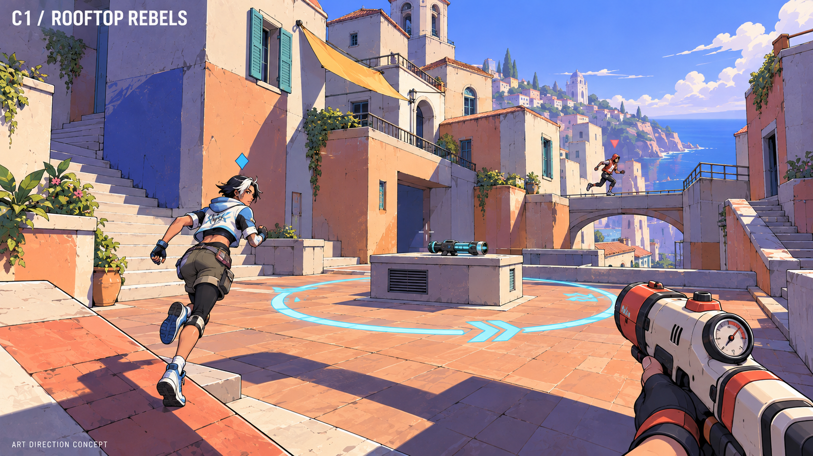
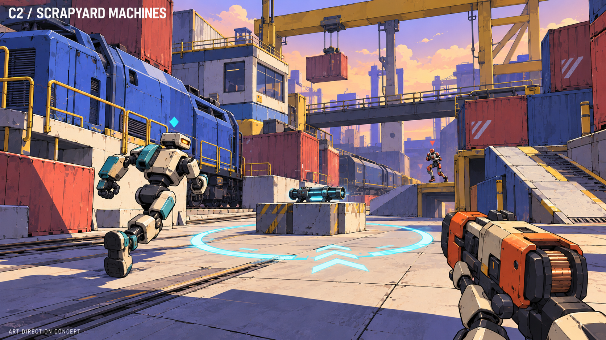
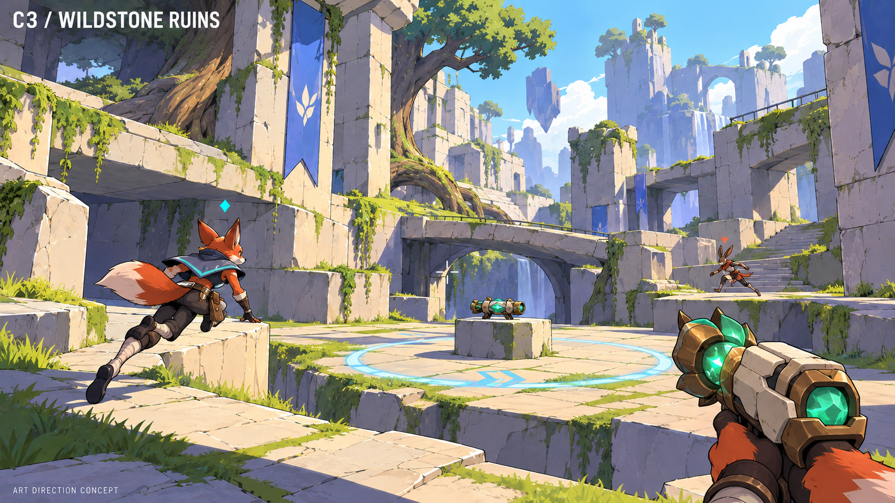

# C — three different FPS worlds

The user selected **C3 / Wildstone Ruins for the map base**, then requested a sleeker,
mostly monochrome modernist refinement. See the [current map concept](README.md)
and [map brief](../superpowers/specs/2026-10-25-wildstone-modern-map-design.md).
The animal characters and their matching equipment are not carried forward:
characters become simple human silhouettes, with weapons explored independently
in the [separate workflow](../superpowers/specs/2026-10-25-characters-weapons-design-workflow.md).

The images below are the historical C1/C2/C3 comparison. They preserve C's comic
shading while varying setting, silhouettes, first-person hands and weapon design.

## C1 — Rooftop Rebels

Warm terracotta and plaster rooftops, balconies and bridges above a coastal city.
Human parkour fighters wear expressive streetwear rather than armored suits.
The player's compressed-air blaster and cloth/glove details match the theme.

## C2 — Scrapyard Machines

Freight trains, container routes, gantry cranes and loading platforms.
Chunky utility robots replace humans; the player's mechanical hand and industrial
rivet cannon reinforce the character direction. Modular large shapes suit repeated
arena construction, although no engine performance has been measured.

## C3 — Wildstone Ruins

Moss-covered pale stone, broken temple terraces, bridges and broad tree roots.
The original picture shows fox and hare adventurers and a stone/bronze/emerald
weapon; those character and equipment themes were not selected. The revised map
also removes most foliage and surface clutter in favor of cleaner modernist forms.

Maps and characters can be selected independently. All three remain FPS views and
retain the capture-zone/weapon-race premise. No gameplay or map layout is approved
merely by selecting an art direction.

Created using the built-in image tool with the original C image as a style
reference. [Exact prompts](C-variations-prompts.md) and all three generated originals
are saved. Images were visually inspected and copied with matching SHA-256 hashes.
They are concept art, not Unity renders, performance tests or final collision layouts.

The first-person weapons remain illustrative: their final scale, screen coverage,
animation and readability need playtesting. Character sizes/shapes must share fair,
readable gameplay hitbox rules if different body types coexist in one roster.

The networking design now targets player-hosted Photon Fusion Host Mode so a player
can run the match from the game without renting or maintaining a game server.
Photon still supplies managed connection/relay services. See the updated
[foundation design](../superpowers/specs/2026-10-25-multiplayer-foundation-design.md).
