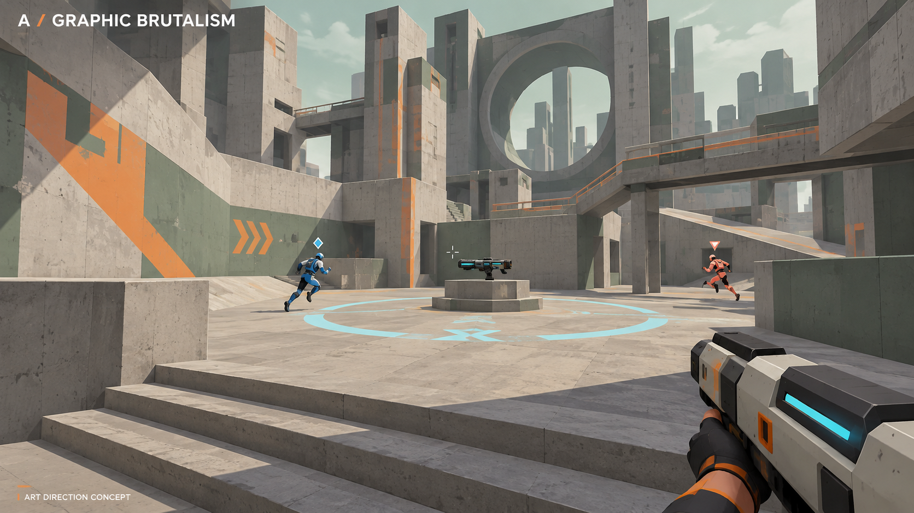
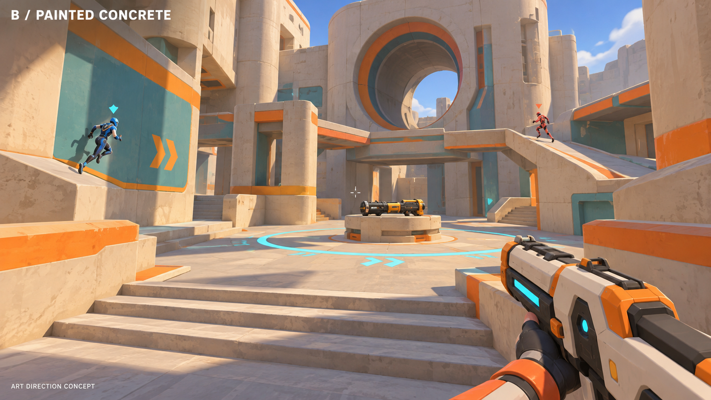
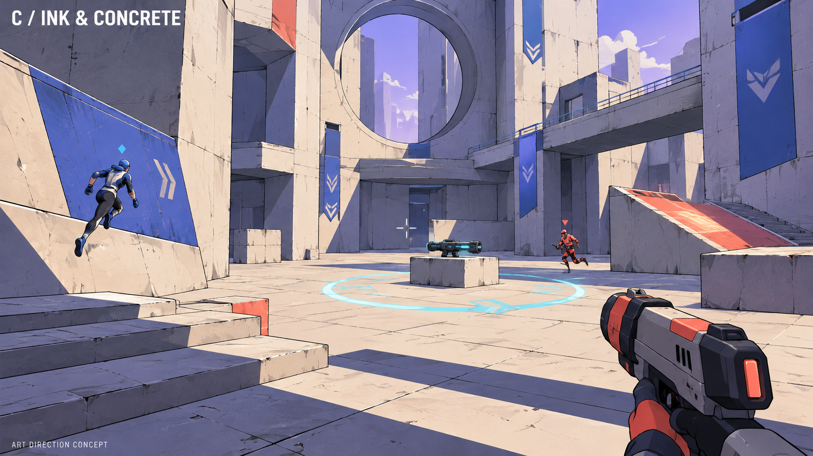

# First-person arena — art direction

Status: the user accepted **C3.1 — Wildstone Modern** as the map visual direction
and its **simple human silhouette character direction**. **C — Ink & Concrete**
remains the base stylization. Exact production assets, collision, layout, balance
and performance remain unapproved or unverified. All four weapon concepts are now
accepted, with simplified materials and softer shading; the original animal characters
and matching equipment do not carry forward.

## Accepted visual direction — C3.1 / Wildstone Modern

Pale stone planes, sharp openings, layered bridges and restrained color. The simple
human direction is accepted; the figures are not final production assets and the
pictured mechanical weapon does not establish a weapon choice.
See the [map brief and layout proposal](../superpowers/specs/2026-10-25-wildstone-modern-map-design.md)
and the separate [character and weapon design workflow](../superpowers/specs/2026-10-25-characters-weapons-design-workflow.md).
The [four accepted weapons](weapon-concepts.md)—Line Driver, Pulse Lobber, Rebound
Disc and Push Lens—now have simpler visual refinements. Their shapes remain
expressive while their surfaces match the soft modern game style. Grenades, stun
guns, laser swords, Blink and temporary shield are included in the
[combat spec](../superpowers/specs/2026-10-25-arena-combat-items-zone-design.md).
The [Unity rendering spec](../superpowers/specs/2026-10-25-unity-rendering-design.md)
defines soft lighting, economical material/effect tricks and measured acceptance.

Generated with built-in ImageGen; the [exact refinement prompt](C3-modern-prompts.md)
is saved. Map examples are FPS concept images, not engine renders; no art has been
applied to a game. The [C1/C2/C3 comparison](C-variations.md) and original A/B/C
comparison below are retained as history.

The reference is [VHOLUME on Steam](https://store.steampowered.com/app/4131730/VHOLUME/):
monumental concrete forms, layered traversal and industrial spaces. These original
concepts make that architecture more stylized while adding our arena objective and
weapon context. They share a scene brief, not pixel-identical geometry.

## A — Graphic Brutalism

Angular concrete, sage and orange markings, restrained color and hard shadows.
Closest of the three to the reference's austere architectural mood. Proposed engine
treatment: simple materials, sparse decals, baked lighting and no outline pass.

## B — Painted Concrete

Warm ivory, teal and orange; chunky bevels and broad painted shading. An earlier
candidate; the user chose C. Proposed engine
treatment: reusable low-detail meshes, broad texture variation and baked shading.
Bevels should help silhouettes rather than adding invisible geometry everywhere.

## C — Ink & Concrete

Cream concrete, blue-violet shadows, coral accents and selective comic contours.
Strongest graphic stylization. Proposed engine treatment: simple toon lighting;
restrict outlines to characters and selected silhouettes. Outlines must be checked
for distance shimmer and cost before adoption.

## Shared requirements

- Preserve FPS visibility and clean silhouettes during fast parkour and fights.
- Team/enemy identification uses shapes/labels and contrast as well as color.
- Use neutral world values around important combat silhouettes; the blue character
  against the blue wall in C is a readability issue to resolve in an engine sample.
- Plan mostly opaque materials, a limited material palette, baked world lighting,
  restrained particles and low-cost distant geometry. The pictures do not prove
  those techniques or any specific frame rate.
- Avoid full-screen noise, motion blur, depth of field and effects that obscure the
  target. Profile an eight-player action scene, not only an empty environment.
- The gun occupies more screen space in these concepts than the final gameplay
  target; final viewmodel placement must be tested at the supported aspect ratios.

Generated using the built-in image tool; exact [prompts](prompts.md) are saved.
All three requested originals are preserved here. The downloaded official screenshot
in `references/` is credited inspiration, not a distributable asset for the new game.

Networking remains the first implementation priority. The reviewed but unapproved
[foundation design](../superpowers/specs/2026-10-25-multiplayer-foundation-design.md)
records the proposed foundation and test gates. The latest user request replaces
dedicated hosting with player-hosted Fusion Host Mode; the design now reflects it.
