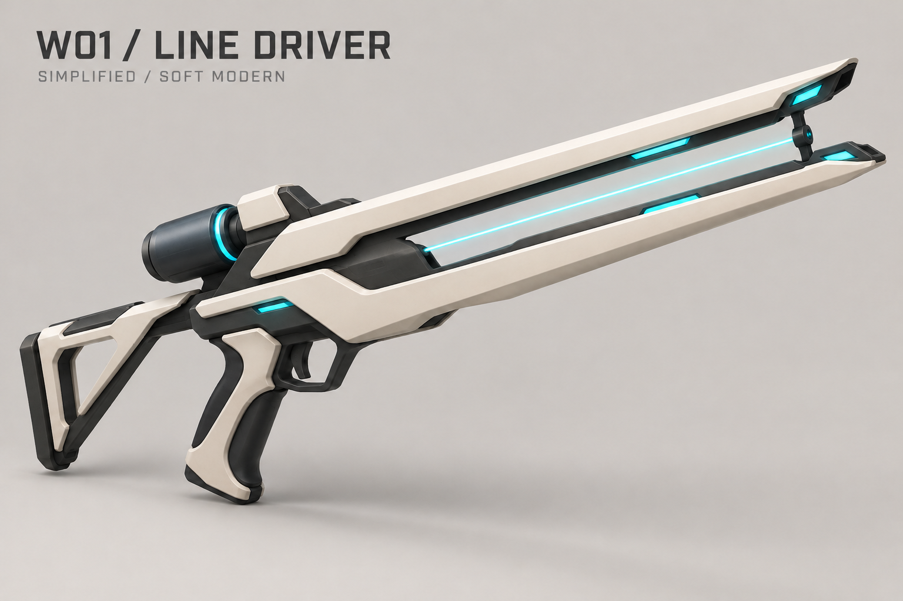
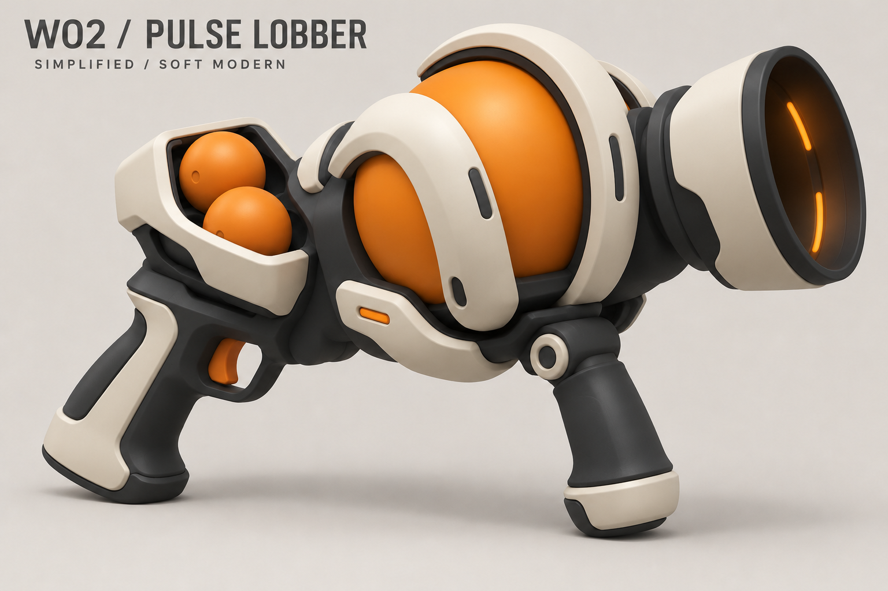
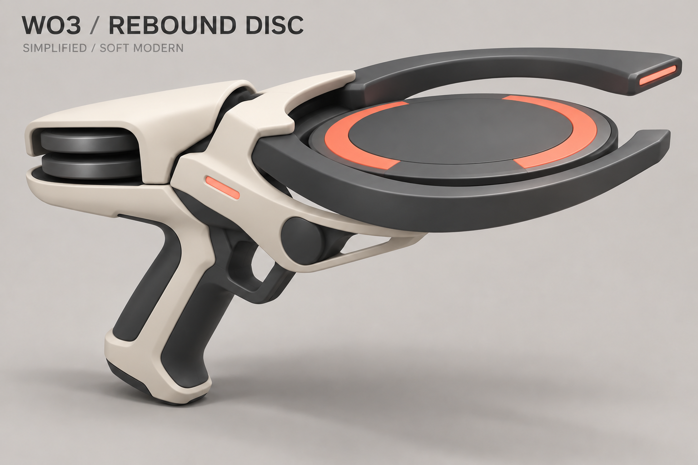
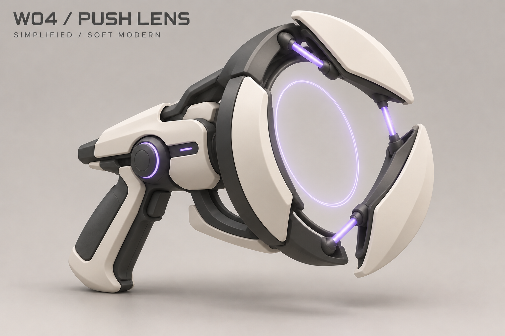

# Accepted weapons — simplified standalone concepts

Date: 2026-10-25. C3.1 / Wildstone Modern and its simple human character direction
are accepted. The user approved all four simplified `*-simple-v2.png` designs below
as the shape/material references for production. This second visual pass
simplifies their surfaces and lighting for the game's style; final meshes and numeric
balance are not proved by these images. Grenades, stun guns, laser swords, short Blink
and temporary shield are added in the [combat spec](../superpowers/specs/2026-10-25-arena-combat-items-zone-design.md).

Each image isolates one weapon on a neutral backdrop. Shared ivory/graphite materials
connect the set; shape, mechanism and a small accent distinguish its proposed role.
The accents identify the concept, not a team assignment. Weapons are not constrained
to the characters' simple silhouette treatment or the map's architecture.

## W01 — Line Driver

**Idea:** precise direct fire through an open split-rail emitter.
Long narrow silhouette, exposed charge path and cyan slits. Intended to reward aim;
cover and line-of-sight breaks are the first counterplay to test. The long rails need
first-person framing and wall-proximity checks before production modeling.

## W02 — Pulse Lobber

**Idea:** lob slow bouncing pulse orbs into contested space.
Round amber chamber, short cup muzzle and visible orb feed give it a heavy playful
profile. Orb travel, bounce limits, lifetime and detonation cues need prototyping;
opponents should have a readable opportunity to dodge or escape. No damage or
detonation rules are fixed by the illustration.

## W03 — Rebound Disc

**Idea:** fire discs that ricochet around cover.
Broad shallow launch platter, crescent guides and visible spare discs communicate
spin and angle attacks. Test a bounded number of bounces with clear travel and impact
cues. The wide body must leave the aiming region visible in first person.

## W04 — Push Lens

**Idea:** emit a directional shockwave to displace opponents from the zone or cover.
Open ring, three separated vanes and a restrained violet lens create a distinct
physics-tool silhouette. Prototype readable windup, limited reach and escape options;
do not infer a stun, damage value or guaranteed knock-off from the image. Keep the
ring effect inexpensive and transparent enough to preserve target visibility.

## Review and next evidence

All four are kept. Tiny seams, texture grain, internal machinery and surface gloss
are reduced; the orb now uses a simple opaque core. Preserve these simpler forms
in Blender/Unity rather than restoring photographic detail. The next visual step is a matched
first-person, opponent-held and pickup comparison, with ready/attack/recovery cues.
Animation, common character hit-envelope checks and measured host/client performance
remain in the [design workflow](../superpowers/specs/2026-10-25-characters-weapons-design-workflow.md).
Networking remains first in implementation order.

Created with built-in ImageGen; [simplification prompts](weapon-simplification-prompts.md)
and the [original prompt set](weapon-concepts-prompts.md) are saved. All four simplified
images were visually inspected and their workspace copies verified with SHA-256.
Originals are preserved: [W01](W01-line-driver.png), [W02](W02-pulse-lobber.png),
[W03](W03-rebound-disc.png), [W04](W04-push-lens.png).
These are concept illustrations, not engine assets or performance evidence.
