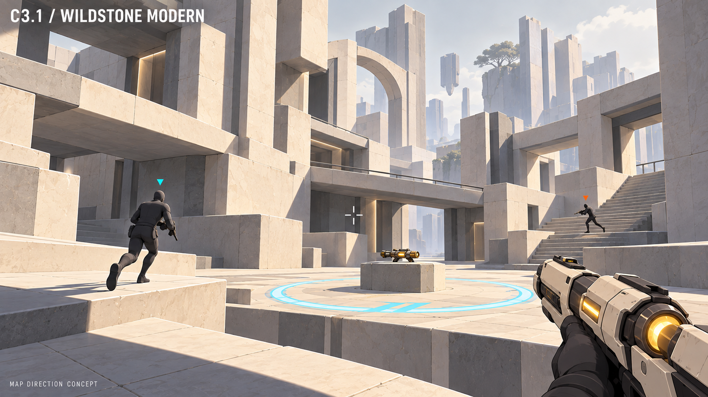

# Wildstone Modern — map direction

Date: 2026-10-25. Status: the user accepted **C3.1 / Wildstone Modern** as the map
visual direction and its simple human character direction. Exact assets, collision
and the layout proposal below remain unapproved. No Unity map or performance result
exists yet.

## Selected direction

Keep C3 / Wildstone Ruins' layered terraces, bridges, interrupted monumental walls
and central courtyard. The user wants a sleeker, mostly monochrome modernist design.
Use C / Ink & Concrete's graphic treatment with simpler surfaces and restrained
contours, softened toward VHOLUME's lighting reference. Prefer broad gentle light
transitions and matte forms to harsh comic bands or glossy detail. The environment
should look intentional and finished at gameplay scale. The
[Unity rendering spec](2026-10-25-unity-rendering-design.md) owns the technical strategy.

This built-in ImageGen concept establishes the accepted atmosphere, architectural
language and simple human direction, not collision geometry or final character
assets. The mechanical weapon remains provisional context. Production validation
and weapon exploration follow the separate
[character and weapon workflow](2026-10-25-characters-weapons-design-workflow.md).
All four [standalone weapon concepts](../../art-direction/weapon-concepts.md) are
accepted and have simpler visual refinements. The expanded roster, Blink, shield
and moving-zone scoring are owned by the
[combat spec](2026-10-25-arena-combat-items-zone-design.md).
The picture's matching triangle markers need distinct shapes in production, its
weapon screen coverage needs testing, and its surface texture should be simplified
further if it creates noise at combat distance.

## Architecture and rendering language

- **Forms:** broad planar walls, precise joints, cantilevered slabs, rectangular
  openings and occasional abstract arch remnants. Use gaps and interrupted volumes
  to retain the ruin identity. Avoid rubble piles and ornate temple ornament.
- **Values:** warm ivory, pale stone, ash gray and charcoal. Read routes through
  silhouette, light and shadow rather than large painted color blocks. Functional
  team, pickup and objective accents may use small amounts of color.
- **Materials:** matte stone/concrete with broad variation; sparse seams and wear.
  Keep most surfaces opaque. Fine cracks, dense vines and grassy carpets from C3
  are removed. A distant sparse tree is optional dressing, not essential identity.
- **Depth:** broad soft-edged shadows, gentle ambient fill, clear foreground/midground
  separation and a quiet skyline. Avoid white-on-white washout and dark figures
  vanishing in shade. Softness comes from lighting and forms, not motion blur.
- **Economy:** propose a small reusable kit of wall, floor, bridge, ramp, stair,
  cover and opening pieces. Bake static world lighting where compatible with the
  selected stylized shader. Restrict outlines to places where tests show a benefit.
  Neither the image nor this material strategy demonstrates a frame-rate saving.

Preserving the lush temple appearance would conflict with the requested refinement;
replacing everything with a flat abstract box arena would discard the selected C3
spatial identity. The chosen direction keeps that identity through clean modernist
forms. Exact shader, palette values and module dimensions remain builder proposals.

## Initial layout proposal

Design for four teams of up to two, including partially filled teams. Start with
two main combat elevations and a connected circulation loop. Skyline structures
can suggest more height without adding inaccessible combat positions.

| Area | Purpose | Required layout property |
| --- | --- | --- |
| Four outer arrival courts | Separate initial team approaches | Room for two; no direct opening spawn sightline; comparable travel effort to contested rewards |
| Central court | Strong early weapon race and an objective passage | Several entrances, edge cover, short exits; avoid an exposed bowl watched from every balcony |
| Side galleries and terraces | Alternate weapon races and flanks | Connected outer loop; each valuable pickup has more than one approach |
| Elevated bridge routes | Vertical repositioning and crossfire | Limited sightlines and multiple ways up/down; no single perch controls every objective segment |
| Broad connecting ramps | Moving-zone travel between spaces | Continuous walkable route, enough width for the zone and contesting players; no travel across a void |

Proposed objective circuit: central court → east terrace → rear gallery → west
terrace → central court, using broad ramps between levels. This is a spatial
proposal, not approved movement speed, scoring, timing or pickup balance. The
central ring in the concept shows only one point along the path. Place additional
weapon opportunities around the loop so the center is valuable without being the
only viable opening. Put pickup plinths outside travel pinch points.

Use architectural landmarks—an interrupted arch, stepped tower, long gallery and
open court—to aid orientation within a monochrome palette. Balance paths by measured
travel time, exposure and escape options rather than assuming visual symmetry is
fair. Do not add smaller-team buffs or special spawn rules through this art brief.

## Authoring and validation sequence

1. After the foundation's movement and minimal combat gates, reuse the source's
   level data and authoring tools in the separate project. Audit the available kit;
   greybox the loop, four arrival courts and two elevations before decorative work.
2. Measure each team's opening routes to the center and side pickups using the same
   movement inputs. Record exposure and exits; test uneven teams as well as 2v2v2v2.
   Revise routes that consistently grant one start a dominant uncontested reward.
3. Sweep the full moving-zone footprint along its route and contest it in motion.
   Check obstructions, stairs, corner transitions, escape routes, spawn visibility
   and low/high-angle lines of fire. Continuous travel must not hide sudden unsafe
   drops or force everyone through one campable doorway.
4. Apply one finished material/lighting slice. Test human silhouettes, team symbols,
   weapons and effects against both light and dark surfaces in moving captures,
   with low graphics settings and color-accessibility previews.
5. Expand art only after route tests, readability review and eight-player host/client
   profiling meet the [foundation gates](2026-10-25-multiplayer-foundation-design.md).
   Record CPU, GPU and memory evidence on the agreed hardware. A pretty empty map
   is insufficient evidence for a busy match.

Networking remains first in implementation order. Concept work can proceed alongside
foundation design. Build reusable kit pieces in Blender where appropriate and assemble
routes with Unity's adapted level tools under the [asset pipeline](../../ASSET-PIPELINE.md).
This map brief does not fix numeric weapon balance or establish competitive fairness.
